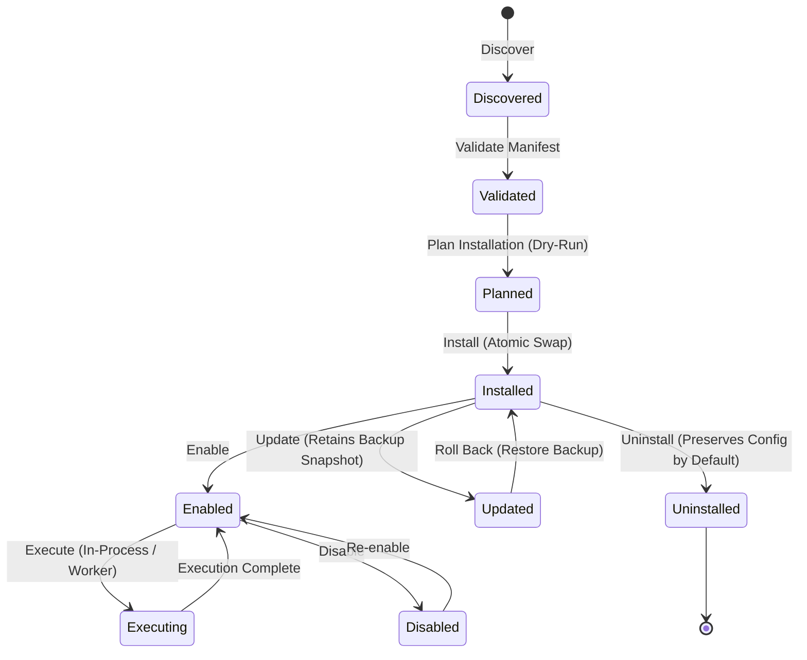

# LogicFalcon Extension Platform

The **LogicFalcon Extension Platform** provides a secure, backward-compatible, capability-based plugin system for extending LogicFalcon's deterministic engineering intelligence, automated code review rules, and Forward Deployment Engineering (FDE) workflows.

---

## 1. Runtime Extensions vs. IDE Extensions

It is critical to distinguish between the two types of extensions in the LogicFalcon ecosystem:

| Extension Type | Location | Language | Target Runtime | Purpose |
| :--- | :--- | :--- | :--- | :--- |
| **Runtime Extensions** | `~/.logicfalcon/extensions/` or `.logicfalcon/extensions/` | Python | LogicFalcon CLI / SDK Engine | Custom AST rules, security checks, metrics analyzers, and FDE execution adapters. |
| **IDE Extensions** | `extensions/` (in repository root) | TypeScript | VS Code / Cursor / Antigravity IDE | Visual editor integrations, editor commands, language server bridges, and sidebars. |

*This platform governs **Runtime Extensions**.*

---

## 2. Complete Lifecycle Support

The platform manages the full lifecycle of an extension with explicit state machines and non-destructive dry-run planning:



1. **Discover**: Scans workspace (`.logicfalcon/extensions/`) and user (`~/.logicfalcon/extensions/`) scopes.
2. **Inspect**: Reads manifest metadata, permissions, and status without executing any extension code.
3. **Validate**: Strictly checks syntactic schemas, SemVer compatibility, and entry points.
4. **Plan**: Non-mutating simulation previewing target directories, capability requirements, and dependencies.
5. **Install**: Atomic directory staging and swap with permission hardening (`0o600` on state files).
6. **Configure**: Manages custom extension configuration parameters.
7. **Enable / Disable**: Explicit lifecycle state control; disabling preserves user data and configuration.
8. **Execute**: Dual-mode execution engine (in-process for trusted rules, isolated worker subprocess for isolation).
9. **Monitor & Doctor**: Non-destructive diagnostic health checks inspecting filesystem integrity and host compatibility.
10. **Update**: Deploys newer version while retaining previous version snapshot for instant recovery.
11. **Roll Back**: Reverts extension to prior snapshot if an update proves defective.
12. **Uninstall**: Cleans directory while preserving user configuration by default (optional `--purge`).

---

## 3. Quickstart CLI

### Listing Extensions
```bash
logicfalcon extension list
```

### Validating a Manifest
```bash
logicfalcon extension validate path/to/extension/
```

### Dry-Run Installation Preview
```bash
logicfalcon extension install path/to/extension/ --dry-run
```

### Installing and Enabling
```bash
# Install to user scope (~/.logicfalcon/extensions/)
logicfalcon extension install path/to/extension/

# Or install to workspace scope (.logicfalcon/extensions/)
logicfalcon extension install path/to/extension/ --workspace

# Enable the extension
logicfalcon extension enable <extension-id>
```

### Running Diagnostics
```bash
logicfalcon extension doctor
```

---

## 4. Documentation Index

- [Architecture & Isolation](architecture.md)
- [CLI Reference](cli-reference.md)
- [Manifest Specification](manifest-spec.md)
- [Developer Guide & SDK](developer-guide.md)
- [Security Model & Sandboxing](security-model.md)
